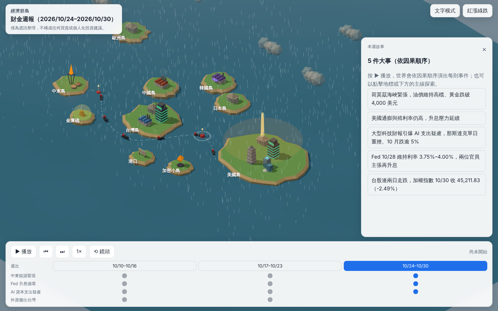
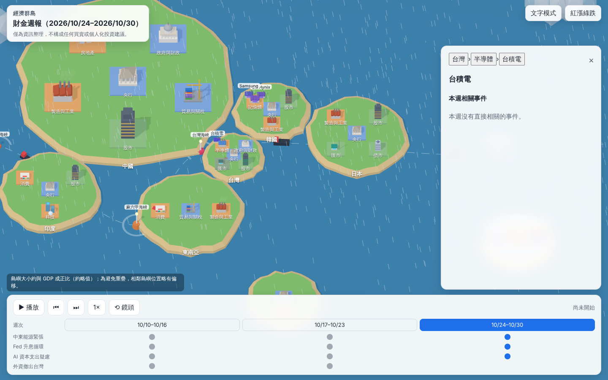
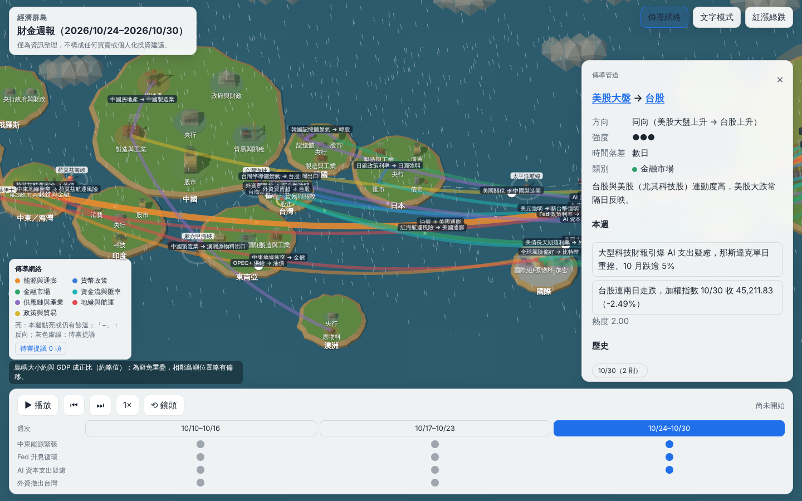
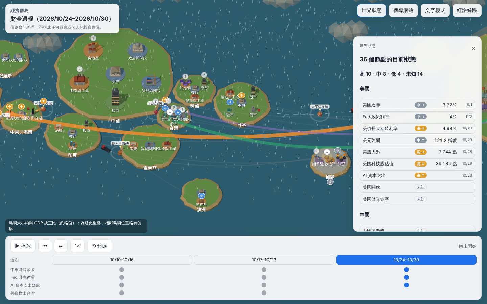
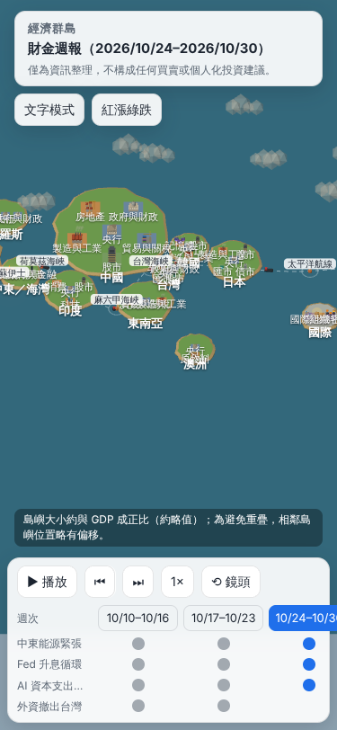

# 經濟群島 econ-archipelago

把每週的《財金週報》演成一個可互動、會隨時間演化的 3D 經濟世界：總體金融世界的數位孿生。

**線上版：** https://jason930930.github.io/econ-archipelago/



世界依**真實地理位置**排列（以東經 150° 為中心、太平洋置中），共 15 個主要經濟體加上「海域」與「國際」。島的面積約與 GDP 成正比（IMF《世界經濟展望》2026 年 10 月版的約略值）。每座島上有部門區塊（央行、股市、半導體、能源……），區塊裡再放具體的公司、組織與商品。地標會隨真實指標變化：

- 油價越高，中東油田的火焰越大、航道上的油輪越多。
- 殖利率越高，美債塔越高。
- 交易所的燈光顯示漲跌，預設紅漲綠跌，可切換。
- 整週的市場情緒決定全世界的天氣：晴天、多雲、陰天或暴風雨。

按下 ▶，世界會依事件之間的**因果順序**逐一演出：

1. 鏡頭飛到事件發生的地點，地標播放動畫。
2. 粒子沿因果連線流向下一個地點，例如「能源價格推升通膨」。
3. 若事件對台灣有影響，會有一道漣漪傳到台灣島。
4. 最後一幕會在各地插上「下週值得關注」的旗幟。



### 常駐傳導網絡

世界底下有一張常駐的**傳導網絡**：40 條精選的傳導管道（其中 11 條與台灣有關），例如「油價 → 美國通膨」「美國長天期殖利率 → 科技股估值（反向）」「美股 → 台股」「外資買賣超 → 新台幣」。

- 每條管道有方向（同向或反向）、強度、時間落差（數日、數週、數月）與機制說明。這些是教科書層級的定性判斷，不是量化模型或預測。
- 週報寫明的因果會在週檔標上管道，網站算出每條管道本週的**熱度**（本週強度＋上週熱度的一半，半衰期 1 週）。點亮的管道是亮管，裡面有流動的光點；連續兩週以上點亮時，光點會加速。沒有點亮的管道是半透明的暗管。
- 播放時，因果連線若有標管道，粒子會沿著那條管線流動，管線也會短暫加亮。
- 按頂欄的「傳導網絡」可以一次看到整張網：所有管道提亮、拉近時顯示名稱，島嶼與建築變淡。
- 點擊管線會開出管道面板：兩端節點、方向、強度、機制、本週點亮它的事件，以及歷來點亮的週次。
- 精選清單以外的關係，排程只能在週檔「提議」；提議以灰色虛線顯示為「待審提議」，不參與任何推演，經人工審閱才會收錄。
- 收錄提議：在 `src/world/channels.ts` 的 `CHANNELS` 加一條管道，沿用提議的 id，起點與終點節點的路徑和提議的 `fromPath`、`toPath` 相同（需要時先在 `CHANNEL_NODES` 加節點）。舊週檔裡的提議不用改，驗證器會把它視為已收錄。



### 完整狀態鏡像

傳導網絡的 36 個節點，每個都有一張**狀態卡**：目前水準（相對過去 5 年的高／中／低）、近期方向（↑ → ↓）、資料日期與來源。

- **16 個節點每天自動更新**：GitHub Actions 每天台北 06:17 從 FRED（聖路易聯邦準備銀行）抓取油價、美國與歐元區通膨、Fed／ECB／日銀利率、美債殖利率、美元、美股、Nasdaq、歐洲天然氣、日圓、鐵礦砂、比特幣、VIX、新台幣，有變動才提交並重新部署。世界在兩次週報之間也會變化。
- **金價與台股**沿用週報的指標。
- **其餘 18 個節點**（地緣、航運、AI 資本支出、關稅、外資、台積電、台海……）由每週排程依週報填寫定性判斷；週報沒提到時沿用最近一次，並標示「沿用 N 週前」，8 週沒更新就淡化。
- 水準以 5 年百分位計算（≥ 80 高、≤ 20 低）；方向比較 4 週前（月資料比 3 個月前），變化超過過去 5 年同間隔變化標準差的一半才算 ↑／↓。
- 拉近或開網絡模式時，每個節點有一個狀態徽章（箭頭＝方向、顏色＝水準：低藍、中灰、高橙，刻意不用紅綠以免和漲跌混淆）。點徽章或節點會開出狀態卡（數值、5 年區間條、走勢圖、來源連結）；頂欄「世界狀態」列出全部 36 個；本週故事面板列出「本週狀態轉變」。
- 看較早的週時，狀態是那個週五的樣子。

> 高／中／低為相對過去 5 年的位置，不代表好壞，也不是預測。部分數據來自 FRED（聖路易聯邦準備銀行），各指數版權屬原提供者。



> 僅為資訊整理，不構成任何買賣或個人化投資建議。

## 功能

- **三層實體模型**：每個位置都有一條路徑，例如 `us`（國家）、`us/central-bank`（部門）、`tw/semiconductor/tsmc`（公司）。週報事件可以對應到任一層。點擊世界中的任何東西，面板會顯示麵包屑（台灣 › 半導體 › 台積電），以及這個節點與它底下所有位置的相關事件。
- **世界自己會長**：週報出現沒見過的公司時，排程會在週檔的 `newEntities` 新增它，世界會依部門原型自動生成一棟建築；引用島上原本沒有的部門（例如日本房地產），也會自動長出區塊。驗證器會擋下重名或別名衝突（不分大小寫、忽略空白）。
- **6 層繪圖元件**：地形 → 部門區塊 → 建築（18 種部門原型＋自動生成的實體建築）→ 指標儀表 → 特效 → 標籤（依縮放程度顯示或隱藏）。

- **故事播放**：依週報中寫明的因果關係排序（拓撲排序；遇到循環時改依重要性排序），可暫停、切換上一則或下一則，也可以用 2× 播放。
- **自由探索**：可拖曳、縮放鏡頭。點擊地標會列出本週相關事件，以及相關指標近 12 週的走勢。
- **跨週時間軸**：切換週次時，世界會從上一週的狀態漸變過去。「主線」（例如 Fed 升息循環、AI 資本支出疑慮）會把不同週的事件串起來。
- **誠實呈現資料**：
  - 來源之間數字不一致時會保留「數據出入」，並以虛線框標示。
  - 某週缺少的指標會沿用上週的數值，並標示「沿用上週」，不會自行補造。
  - 「對台灣的影響」只依週報原文填寫。
- **分享連結**：`#/2026-10-30/e3` 會直接開到某一週的某一則事件。
- **文字模式**：內容與 3D 版相同。瀏覽器不支援 WebGL 時會自動切換過去。
- **手機版**：面板改為底部 sheet，並降低特效品質以節省效能。

| 手機版 |
|---|
|  |

## 每週自動更新

```
每天 06:17（台北）GitHub Actions「每日更新 FRED 節點狀態」
  └─ 抓 FRED → data/state/fred.json → 驗證、單元測試 → 有變動才提交 main → 觸發部署

每週六 08:52（台北）排程「每週財金五大事」
  ├─ 搜尋新聞、撰寫週報 → 推播＋寄信
  └─ 依 docs/WEEKLY_DATA_GUIDE.md 轉成 data/weeks/<週五>.json
       └─ npm run validate
            ├─ 通過 → push main → GitHub Actions 驗證、測試、部署 Pages
            └─ 失敗 → push data/week-<日期> 分支，網站維持上一版
```

資料格式與規則：`docs/WEEKLY_DATA_GUIDE.md`、`schema/week.schema.json`。

## 架構

```
data/weeks/*.json            每週資料 v2（唯一的資料來源）
data/world/entities.json     種子實體（公司、組織、商品、航道）
data/state/fred.json         FRED 快照（每週五樣本＋最新值，每日自動更新）
schema/week.schema.json      JSON Schema v2
src/world/                   地區、部門、路徑、投影、GDP 版面、實體清單、指標綁定、傳導管道與熱度、節點狀態（純邏輯）
src/data/                    驗證、遷移、指標補值、索引（純邏輯）
src/story/                   因果排序、播放狀態機（純邏輯）
src/render/graph.ts          WorldGraph：以路徑索引的節點樹（地區 → 部門 → 實體）
src/render/layers/           L0 地形、L1 區塊、L2 實體節點、L4 傳導管線、狀態徽章、L5 標籤、航線
src/render/landmarks/        18 種部門原型建築
src/render/gauges/           8 種指標儀表（火焰、光柱、樓層、燈帶、光暈、閃爍、旗幟、熱霧）
src/ui/                      節點面板（麵包屑）、狀態卡與世界狀態、管道面板、事件卡、時間軸、控制列、文字模式、路由
scripts/fetch-fred.ts        每日 FRED 抓取（單一序列失敗沿用舊值，全部失敗不寫檔）
```

所有地點都用路徑表示，傳導網絡的節點也直接用這套路徑；後續的狀態鏡像與情境推演會沿用同一張網。`render/` 只接收算好的儀表讀數（`{ level, trend, status }`），資料、世界版面與播放邏輯都能在 Node 中做單元測試。

技術：TypeScript、Vite、Three.js、ajv、Vitest、Playwright。

## 本機開發

```bash
npm ci
npm run dev        # 開發伺服器（會先產生索引）
npm run validate   # 驗證 data/weeks/*.json 與 data/state/fred.json
npx tsx scripts/fetch-fred.ts   # 手動更新 FRED 快照（需要網路）
npm test           # 單元測試
npm run e2e        # 建置後跑瀏覽器煙霧測試
npm run build      # 驗證 → 產生索引 → 建置到 dist/
```

## 設計文件

- 規格：`docs/superpowers/specs/2026-11-02-econ-archipelago-design.md`
- 實作計畫：`docs/superpowers/plans/2026-11-02-econ-archipelago.md`
- 世界骨架 v2：`docs/superpowers/specs/2026-11-02-world-skeleton-v2-design.md`
- 常駐傳導網絡：`docs/superpowers/specs/2026-11-02-transmission-network-design.md`、`docs/superpowers/plans/2026-11-02-transmission-network.md`
- 完整狀態鏡像：`docs/superpowers/specs/2026-11-02-state-mirror-design.md`、`docs/superpowers/plans/2026-11-02-state-mirror.md`
